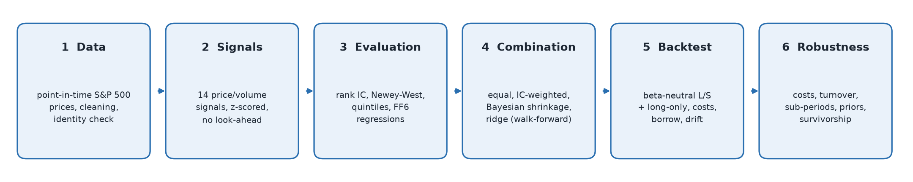
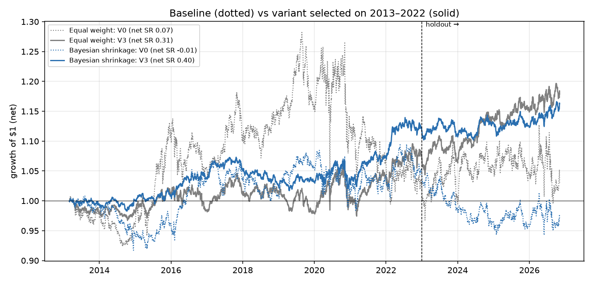

# Equity Alpha Research: point-in-time S&P 500

An end-to-end, reproducible research pipeline for cross-sectional equity signals: from raw free data to a
cost-aware, market-neutral backtest. It treats free data like production data and every result is out of
sample. The core idea is a **hierarchical Bayesian combination of signals** (empirical-Bayes shrinkage
with a literature-informed prior, Ledoit-Wolf covariance, non-negative weights). The method is compared
against equal weighting, IC weighting and ridge regression.



> **Short version.** On a survivorship-free S&P 500 universe (2010–2026), 14 published price/volume
> anomalies are individually weak: none clears the t ≥ 3 multiple-testing hurdle. Combined with shrinkage they
> give a small, beta-neutral edge, but as first specified ~85% monthly turnover makes it break-even after
> costs. Three theory-driven improvements were then **chosen on 2013–2022 only**: a statistical (PCA) risk
> model, risk-scaled weights and partial rebalancing. They raise the net Sharpe of the Bayesian book from
> 0.12 to 0.42 in development and from −0.34 to 0.35 on the **untouched 2023–2026 holdout**. A placebo test
> with random scores shows the machinery itself earns nothing, and that the edge is real but modest
> (p ≈ 0.04). Removing delisted stocks (survivors only) would have overstated the net Sharpe by ~15%.
> Methods that limit estimation error (equal weight, Bayesian shrinkage) beat methods that trust historical means.

## Headline results

<!-- RESULTS:START -->

**Stage 5 — as specified up front.** Dollar- and beta-neutral long-short books, monthly rebalance, trading at the close after the signal, 5 bps per dollar traded + 25 bps/year borrow, out of sample 2013-03-01 to 2026-11-05:

| Combination method | OOS composite IC (t) | Sharpe gross | Sharpe net | Vol | Max DD | Turnover / month | Break-even cost |
|---|---|---|---|---|---|---|---|
| Equal weight | 0.0130 (1.2) | 0.21 | 0.07 | 9.4% | -24.5% | 85.6% | 9 bps |
| IC-weighted | 0.0038 (0.3) | 0.03 | -0.08 | 11.1% | -29.3% | 86.6% | 1 bps |
| Bayesian shrinkage | 0.0078 (1.1) | 0.22 | -0.01 | 5.5% | -14.0% | 82.1% | 5 bps |
| Ridge regression | 0.0029 (0.3) | 0.01 | -0.11 | 10.4% | -27.6% | 78.8% | 0 bps |

**Stage 7 — improvements selected on 2013–2022, then judged on the 2023–2026 holdout.** Each step adds one theory-driven idea (see [improvements](reports/improvements.md)):

| Variant | Method | Net Sharpe 2013–22 (dev) | Net Sharpe 2023– (holdout) | Vol | Turnover / month |
|---|---|---|---|---|---|
| V0 baseline (beta-neutral, rank weights, full rebalance) | Equal weight | 0.08 | 0.05 | 9.4% | 85.6% |
| V0 baseline (beta-neutral, rank weights, full rebalance) | Bayesian shrinkage | 0.12 | -0.34 | 5.5% | 82.1% |
| V1 + statistical risk model (5 PCA factors) | Equal weight | 0.07 | 0.30 | 5.4% | 92.7% |
| V1 + statistical risk model (5 PCA factors) | Bayesian shrinkage | 0.28 | 0.11 | 4.1% | 93.1% |
| V2 + risk-scaled weights (z / idio vol) | Equal weight | 0.11 | 0.34 | 5.0% | 92.5% |
| V2 + risk-scaled weights (z / idio vol) | Bayesian shrinkage | 0.30 | 0.09 | 3.7% | 93.7% |
| V3 + trade 50% towards target **(selected)** | Equal weight | 0.20 | 0.58 | 4.2% | 42.0% |
| V3 + trade 50% towards target **(selected)** | Bayesian shrinkage | 0.42 | 0.35 | 2.9% | 42.9% |
| V4 + trade 25% towards target | Equal weight | 0.17 | 0.77 | 3.5% | 21.9% |
| V4 + trade 25% towards target | Bayesian shrinkage | 0.30 | 0.44 | 2.4% | 22.1% |

Placebo test: the selected configuration fed 50 sets of random scores earns a gross Sharpe of -0.01 on average (sd 0.28); the real composite earns +0.64 (empirical p-value 0.039).

<!-- RESULTS:END -->

Full reports with figures: [data quality](reports/data_quality.md) · [signals](reports/signals.md) ·
[single-signal evaluation](reports/evaluation.md) · [combination](reports/combination.md) ·
[backtest](reports/backtest.md) · [robustness](reports/robustness.md) · [improvements](reports/improvements.md).



## What makes it rigorous

| Pitfall | How the pipeline handles it |
|---|---|
| Survivorship bias in the universe | Point-in-time S&P 500 membership (index changes since 1996), not today's list |
| Survivorship bias in prices | yfinance drops delisted stocks, so they are recovered from Tiingo. A robustness test reruns everything on survivors only |
| Wrong data for reused tickers | **Identity check**: a series is accepted only if it trades ≥ $10M/day (median) while the stock is in the index. It caught a vendor returning an OTC penny stock as "GR" (Goodrich) |
| Look-ahead in signals | Signal at close *t*, trade at close *t+1*, first return on *t+2*. A unit test rewrites all future prices and checks no past signal changes |
| Look-ahead in model fitting | Walk-forward weights. A holding period is used only once its return is *known* (one-period embargo). Also unit-tested |
| Overlapping returns | Newey-West t-statistics with h−1 lags |
| Data mining | 14 pre-specified signals from the literature, t ≥ 3 hurdle (Harvey, Liu & Zhu 2016). Parameters fixed a priori, not tuned. Signals added after the first look are labelled |
| Hidden factor bets | Fama-French 5 + momentum regressions of every long-short return |
| Training on what you cannot trade | Returns *and* signals are beta-neutralised before combining, matching the beta-neutral portfolio |
| Frictions | Daily engine with drifting weights, linear costs, borrow fees and turnover. Cost sensitivity 0–30 bps |
| Improving on the same data you test on | Improvements chosen on 2013–2022 only, 2023–2026 holdout reported as is, placebo test with random scores |

## Pipeline

| Stage | Script | What it does |
|---|---|---|
| 1. Data | `build_dataset.py` | Point-in-time membership, prices from yfinance + Tiingo (cached, rate-limited, resumable), identity check, cleaning (stale prices, reverted spikes, no forward-fill), Fama-French factors |
| 2. Signals | `build_signals.py` | 14 signals: momentum (12-1, 6-1, residual), reversal (1w, 1m, residual), 52-week high, volatility, beta, idiosyncratic vol, MAX, skewness, Amihud illiquidity, volume shock. Daily winsorize + z-score within the universe |
| 3. Evaluation | `evaluate_signals.py` | Rank IC at 1/5/21 days, IC decay, IC by year, quintile portfolios, turnover, FF6 regressions |
| 4. Combination | `combine_signals.py` | Walk-forward equal / IC-weighted / Bayesian / ridge weights on beta-neutral signal payoffs |
| 5. Backtest | `backtest.py` | Rank-linear, dollar- and beta-neutral, capped long-short book. Long-only top quintile vs equal-weighted universe |
| 6. Robustness | `robustness.py` | Costs, partial rebalancing, sub-periods, prior sensitivity, leave-one-signal-out, weekly rebalancing, survivorship |
| 7. Improvements | `improvements.py` | Development/holdout protocol: PCA risk model, risk-scaled weights, partial rebalancing; placebo test |

### The Bayesian combination in one paragraph

Each signal's monthly payoff *f<sub>k,m</sub>* (the Fama-MacBeth slope of beta-neutral returns on the
beta-neutral signal) is a noisy measurement of its true premium *μ<sub>k</sub>*. The true premia share a
common level *μ<sub>0</sub>*, and *μ<sub>0</sub>* has a sceptical, literature-informed prior: average IC
0.02 ± 0.02, below published values because anomalies decay after publication. The dispersion
*τ²* of true premia is estimated by method of moments. The common level's uncertainty accounts for the
correlation between signals. Each signal's posterior mean is a precision-weighted blend of its own record
and the common level. Weights then maximise *μ'w − ½w'Σw* subject to *w ≥ 0*, with a Ledoit-Wolf
covariance, so redundant signals (e.g. low-vol and idiosyncratic vol, ρ = 0.94) are not counted twice.
If no premium is positive, the model does not trade. It is the partial pooling a hierarchical Stan model
would give, in closed form so it can be refitted every month.

## Reproduce

```bash
git clone https://github.com/emanueledalo/equity-alpha-research.git && cd equity-alpha-research
python3 -m venv .venv && source .venv/bin/activate
pip install -e ".[dev]"
cp .env.example .env              # add a free Tiingo API key (needed for delisted stocks)
python scripts/run_all.py         # data download is cached; first run takes hours on Tiingo's free tier
pytest                            # unit tests
```

`python scripts/run_all.py --skip-data` reruns the research stages in about 90 seconds once the data is
cached. Data is never committed (`data/` is git-ignored). Reports, figures and `reports/results.json` are.

## Repository layout

```
src/alpha_research/
  config.py              paths, dataset settings, .env reader, results.json writer
  data/                  universe (point-in-time), prices (yfinance, Tiingo), clean, factors, quality report
  signals/               library (14 signals + registry), preprocess (winsorize, z-score), targets
  evaluation/            ic, stats (Newey-West, HAC OLS), portfolios (quintiles), factor_model (FF6)
  combination/           periods (holding periods, embargo, beta-neutralisation), weights (Bayes, LW), composite
  backtest/              construction (neutral, capped weights), engine (drift, costs, borrow)
  risk.py                statistical risk model: [1, beta, PCA factors] exposures, neutralisation
  pipeline.py            shared wiring used by the stage scripts and the robustness tests
scripts/                 one script per stage + run_all.py
tests/                   pytest suite: look-ahead, timing, constraints, statistics, data rules
reports/                 markdown reports, figures, results.json
```

## Limitations

- **Free data.** There are no delisting returns: a delisted stock is closed at its last price. Tickers are
  used instead of permanent identifiers. A few dozen former members are unavailable from either vendor
  (see the data quality report).
- **No fundamentals or historical sectors.** The signals are price/volume only, and the book is
  beta-neutral but not sector-neutral.
- **Linear cost model** and no capacity analysis.
- **Sample.** About 13 years out of sample. A Sharpe ratio of 0.2–0.3 has a standard error of roughly
  0.28 over that horizon.

## Next steps

1. Turnover-aware portfolio construction (alpha minus transaction-cost penalty instead of trading to a
   rank target).
2. Point-in-time fundamentals from SEC EDGAR XBRL (quality, investment, accruals) and earnings-event signals.
3. Sector neutrality using historical SIC codes.
4. A full Bayesian model in Stan with time-varying premia, compared to the closed form by LOO-CV.

## Data sources

- S&P 500 historical constituents: [fja05680/sp500](https://github.com/fja05680/sp500) (MIT licence).
- Prices: [yfinance](https://github.com/ranaroussi/yfinance) and the [Tiingo](https://www.tiingo.com) EOD API.
- Factors: [Kenneth R. French Data Library](https://mba.tuck.dartmouth.edu/pages/faculty/ken.french/data_library.html).

## Key references

Jegadeesh & Titman (1993) · Jegadeesh (1990) · Lehmann (1990) · George & Hwang (2004) · Ang, Hodrick,
Xing & Zhang (2006) · Frazzini & Pedersen (2014) · Bali, Cakici & Whitelaw (2011) · Boyer, Mitton &
Vorkink (2010) · Amihud (2002) · Gervais, Kaniel & Mingelgrin (2001) · Blitz, Huij & Martens (2011) ·
Fama & MacBeth (1973) · Newey & West (1987) · Ledoit & Wolf (2004) · Grinold & Kahn (2000) ·
McLean & Pontiff (2016) · Harvey, Liu & Zhu (2016) · Fama & French (2015).
