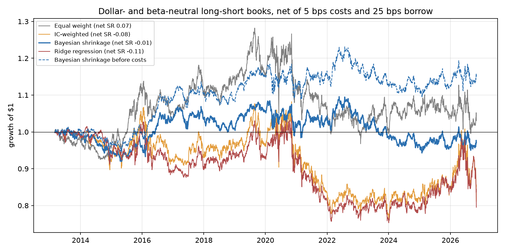
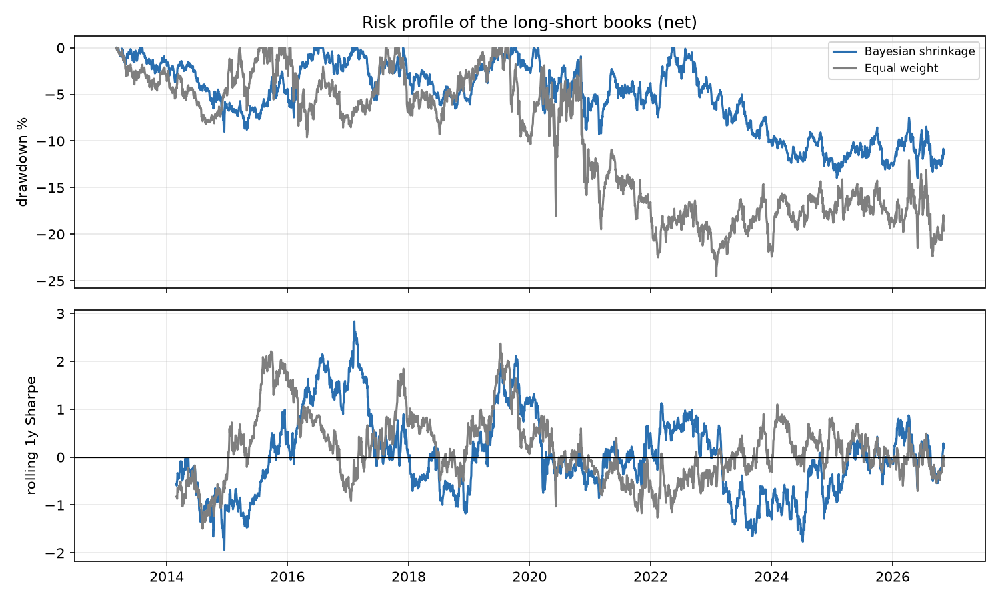
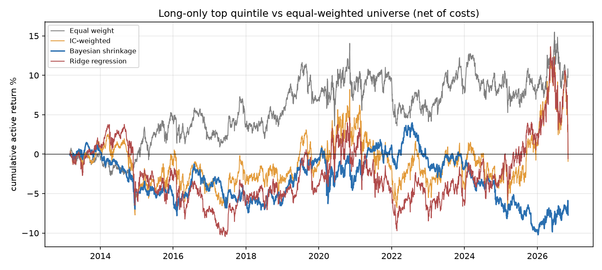

# Stage 5 — Portfolio construction and backtest

Period: **2013-03-01 to 2026-11-05**, monthly rebalance, trades at the close of the day after the signal. Costs: 5 bps per dollar traded (one way) and 25 bps/year borrow on shorts. Primary method declared in advance: **Bayesian shrinkage**; baseline: Equal weight.

## Long-short book (market neutral)

Rank-linear weights, projected to be dollar-neutral and beta-neutral (252-day beta), 100% long / 100% short, max 2% per stock.

| Method | Sharpe gross | Sharpe net | Return net | Vol | Max DD | Realised beta | Turnover/month | Cost drag/yr | Borrow/yr | FF6 alpha net (t) |
|---|---|---|---|---|---|---|---|---|---|---|
| Equal weight | 0.21 | 0.07 | 0.7% | 9.4% | -24.5% | -0.00 | 85.6% | 1.0% | 0.3% | -1.7% (-1.0) |
| IC-weighted | 0.03 | -0.08 | -0.9% | 11.1% | -29.3% | +0.03 | 86.6% | 1.0% | 0.3% | -2.7% (-1.5) |
| Bayesian shrinkage | 0.22 | -0.01 | -0.1% | 5.5% | -14.0% | +0.01 | 82.1% | 1.0% | 0.3% | -0.8% (-0.5) |
| Ridge regression | 0.01 | -0.11 | -1.1% | 10.4% | -27.6% | +0.04 | 78.8% | 1.0% | 0.3% | -2.6% (-1.5) |

### Factor exposures of the Bayesian shrinkage book (net returns, Newey-West t)

| Factor | Loading | t |
|---|---|---|
| alpha (annualised) | -0.8% | -0.53 |
| Mkt-RF | +0.021 | +2.88 |
| SMB | +0.050 | +3.60 |
| HML | +0.026 | +1.44 |
| RMW | +0.036 | +2.22 |
| CMA | +0.017 | +0.75 |
| MOM | +0.099 | +6.97 |
| R² | 0.08 | |

## Long-only book

Equal weight in the top quintile of the composite (~100 stocks), against the equal-weighted universe built with the same engine and costs.

| Portfolio | Return | Vol | Sharpe | Active return | Tracking error | Information ratio | Beta (SPY) | Turnover/month |
|---|---|---|---|---|---|---|---|---|
| Benchmark (equal-weighted universe) | 13.5% | 17.4% | 0.78 | – | – | – | 0.97 | 3.3% |
| Equal weight top quintile | 14.2% | 18.5% | 0.77 | 0.7% | 5.5% | 0.13 | 1.03 | 58.5% |
| IC-weighted top quintile | 13.4% | 18.9% | 0.71 | -0.1% | 7.1% | -0.01 | 1.05 | 56.4% |
| Bayesian shrinkage top quintile | 12.9% | 18.0% | 0.72 | -0.6% | 3.8% | -0.15 | 0.98 | 55.3% |
| Ridge regression top quintile | 13.4% | 18.7% | 0.72 | -0.0% | 6.9% | -0.01 | 1.04 | 51.1% |

Sharpe ratios are computed on total returns (not excess of the risk-free rate), which slightly flatters the long-only books relative to the self-financing long-short books.
