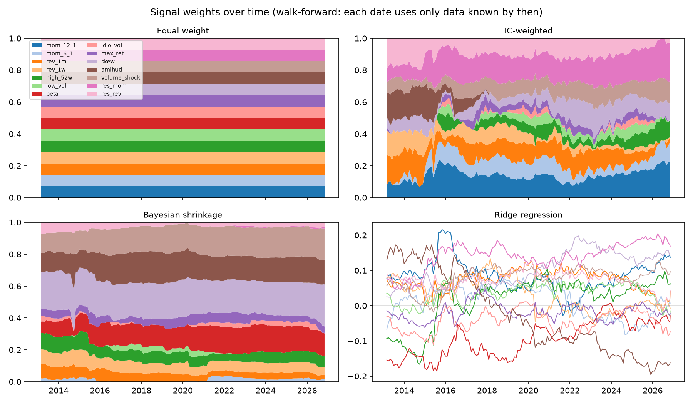
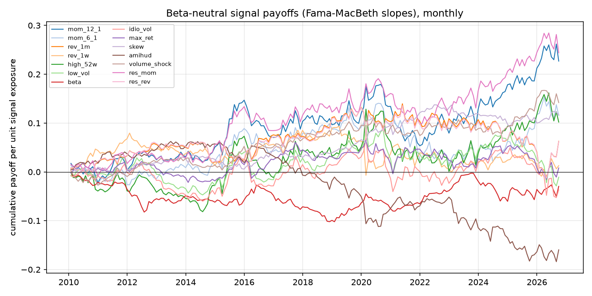

# Stage 4 — Signal combination

Out-of-sample period: **2013-02 to 2026-11** (monthly rebalances). Weights at each date are estimated only from holding periods whose returns were fully known by that date, after a 36-month burn-in. Training returns are beta-neutralised each period, matching the beta-neutral portfolios of Stage 5 ("train on what you trade").

## Methods

| Method | Idea | Estimation risk |
|---|---|---|
| Equal weight | 1/K per signal | none |
| IC-weighted | ∝ historical mean payoff, floored at 0 | high: noisy means are taken at face value |
| Bayesian shrinkage | hierarchical model: each signal's premium is shrunk towards a common level whose prior is literature-informed (average IC 0.02 ± 0.02); Ledoit-Wolf covariance; non-negative mean-variance weights | low: shrinkage on means and covariance |
| Ridge regression | pooled regression of stock returns on all signals, λ = 1 fixed a priori | medium: weights can turn negative |

## Out-of-sample composite IC (rebalance → next rebalance)

| Method | IC (beta-neutral returns) | t | IC IR | Hit rate | IC (raw returns) | t | Months |
|---|---|---|---|---|---|---|---|
| Equal weight | 0.0130 | 1.23 | 0.33 | 58% | 0.0150 | 1.51 | 164 |
| IC-weighted | 0.0038 | 0.31 | 0.08 | 54% | 0.0040 | 0.36 | 164 |
| Bayesian shrinkage | 0.0078 | 1.11 | 0.30 | 55% | 0.0077 | 1.09 | 164 |
| Ridge regression | 0.0029 | 0.26 | 0.07 | 55% | 0.0026 | 0.25 | 164 |

## Signal weights over time

## What the signals actually paid (beta-neutral)

## Bayesian posterior at 2026-09-30

Estimated dispersion of true premia across signals τ = 0.0000 (in IC units); Ledoit-Wolf shrinkage intensity of the payoff covariance δ = 0.05.

| Signal | Sample IC | Posterior IC | Shrinkage to common level | Weight |
|---|---|---|---|---|
| `mom_12_1` | +0.0153 | +0.0042 | 1.00 | 0.00 |
| `mom_6_1` | +0.0073 | +0.0042 | 1.00 | 0.02 |
| `rev_1m` | +0.0021 | +0.0042 | 1.00 | 0.02 |
| `rev_1w` | +0.0011 | +0.0042 | 1.00 | 0.05 |
| `high_52w` | +0.0069 | +0.0042 | 1.00 | 0.07 |
| `low_vol` | -0.0014 | +0.0042 | 1.00 | 0.00 |
| `beta` | -0.0026 | +0.0042 | 1.00 | 0.14 |
| `idio_vol` | -0.0033 | +0.0042 | 1.00 | 0.00 |
| `max_ret` | -0.0002 | +0.0042 | 1.00 | 0.04 |
| `skew` | +0.0083 | +0.0042 | 1.00 | 0.26 |
| `amihud` | -0.0112 | +0.0042 | 1.00 | 0.15 |
| `volume_shock` | +0.0091 | +0.0042 | 1.00 | 0.20 |
| `res_mom` | +0.0167 | +0.0042 | 1.00 | 0.01 |
| `res_rev` | +0.0021 | +0.0042 | 1.00 | 0.03 |

When τ ≈ 0 the data cannot distinguish the signals' premia from noise, so every signal receives the same posterior premium and the weights are driven purely by the covariance: the model favours signals that diversify each other.
