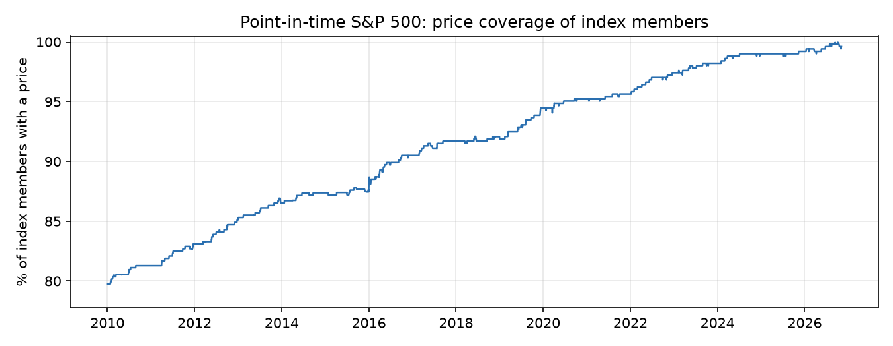

# Data quality report

Universe window: **2010-01-04 to 2026-11-05** · price history from 2008-01-01 · benchmark/calendar: SPY

## Summary

| Metric | Value |
|---|---|
| Tickers ever in the index during the window | 848 |
| Tickers priced from yfinance | 602 |
| Tickers priced from tiingo | 131 |
| Tickers with no price at all | 115 |
| Tickers with partial coverage (<95% of member days) | 20 |
| Average daily coverage of index members | 91.4% |
| Worst day coverage | 79.8% |

## Coverage by year

| Year | Avg members | Avg priced | Avg coverage | Min coverage |
|---|---|---|---|---|
| 2010 | 498 | 403 | 80.8% | 79.8% |
| 2011 | 497 | 408 | 82.1% | 81.3% |
| 2012 | 497 | 417 | 83.9% | 83.1% |
| 2013 | 497 | 427 | 85.9% | 85.3% |
| 2014 | 498 | 434 | 87.1% | 86.5% |
| 2015 | 501 | 438 | 87.5% | 87.1% |
| 2016 | 505 | 453 | 89.7% | 88.1% |
| 2017 | 506 | 462 | 91.3% | 90.5% |
| 2018 | 506 | 464 | 91.8% | 91.5% |
| 2019 | 505 | 470 | 93.0% | 91.9% |
| 2020 | 505 | 479 | 94.9% | 94.1% |
| 2021 | 505 | 482 | 95.4% | 95.0% |
| 2022 | 504 | 487 | 96.7% | 95.6% |
| 2023 | 503 | 492 | 97.9% | 97.2% |
| 2024 | 503 | 497 | 98.8% | 98.2% |
| 2025 | 503 | 498 | 99.0% | 98.8% |
| 2026 | 503 | 500 | 99.5% | 99.0% |

## Cleaning actions

| Issue | Cells |
|---|---|
| stale_price | 4864 |
| spike_reverted | 13 |
| extreme_return_flag | 3 |

`invalid_price`, `stale_price` and `spike_reverted` cells were removed (set to NaN). `extreme_return_flag` cells were kept and are listed below for review.

### Extreme daily returns (|r| > 100%)

| Date | Ticker |
|---|---|
| 2008-11-24 | GGP |
| 2008-12-05 | HIG |
| 2026-08-19 | MRNA |

## Series rejected by the identity check

Price series a source returned for the ticker, but which do not trade like the S&P 500 member during its membership (usually a reused ticker now owned by another company). They are discarded, never mixed in.

| Ticker | Source | Reason |
|---|---|---|
| ADT | yfinance | no price on member days |
| ADT | tiingo | no price on member days |
| ALTR | tiingo | no price on member days |
| APC | yfinance | no price on member days |
| APC | tiingo | no price on member days |
| APOL | tiingo | no price on member days |
| BBBY | yfinance | no price on member days |
| BBT | yfinance | median $ volume on member days 2,409,075 (wrong company?) |
| BBT | tiingo | median $ volume on member days 2,409,075 (wrong company?) |
| BEAM | yfinance | no price on member days |
| BEAM | tiingo | no price on member days |
| BTUUQ | tiingo | no price on member days |
| CA | tiingo | no price on member days |
| CAM | yfinance | no price on member days |
| CMA | yfinance | no price on member days |
| CPWR | yfinance | median $ volume on member days 0 (wrong company?) |
| CSRA | yfinance | no price on member days |
| CSRA | tiingo | no price on member days |
| DNB | tiingo | no price on member days |
| DO | tiingo | no price on member days |
| DTV | tiingo | no price on member days |
| EMC | yfinance | no price on member days |
| EMC | tiingo | no price on member days |
| EP | yfinance | median $ volume on member days 735 (wrong company?) |
| EP | tiingo | median $ volume on member days 36 (wrong company?) |
| FB | yfinance | no price on member days |
| FTR | tiingo | no price on member days |
| GENZ | yfinance | median $ volume on member days 389,980 (wrong company?) |
| GR | yfinance | median $ volume on member days 12,292 (wrong company?) |
| HCP | tiingo | no price on member days |
| INFO | yfinance | no price on member days |
| JAVA | yfinance | no price on member days |
| KG | yfinance | median $ volume on member days 1,433,325 (wrong company?) |
| KG | tiingo | no price on member days |
| LB | yfinance | no price on member days |
| LB | tiingo | no price on member days |
| LEG | yfinance | no price on member days |
| LIFE | yfinance | no price on member days |
| LIFE | tiingo | no price on member days |
| LSI | tiingo | median $ volume on member days 7,338,187 (wrong company?) |
| LXK | tiingo | no price on member days |
| MI | yfinance | no price on member days |
| MI | tiingo | no price on member days |
| MIL | tiingo | median $ volume on member days 3,114,990 (wrong company?) |
| MMI | yfinance | no price on member days |
| MMI | tiingo | no price on member days |
| MON | tiingo | no price on member days |
| NE | yfinance | no price on member days |
| NE | tiingo | no price on member days |
| NFX | yfinance | no price on member days |
| NFX | tiingo | no price on member days |
| NSM | tiingo | no price on member days |
| PARA | yfinance | median $ volume on member days 126,735 (wrong company?) |
| PARA | tiingo | median $ volume on member days 135,875 (wrong company?) |
| PCL | yfinance | no price on member days |
| PLL | tiingo | no price on member days |
| POM | yfinance | no price on member days |
| POM | tiingo | no price on member days |
| QLGC | tiingo | no price on member days |
| QRVO | yfinance | no price on member days |
| RSHCQ | tiingo | no price on member days |
| S | yfinance | no price on member days |
| S | tiingo | no price on member days |
| SATS | yfinance | no price on member days |
| SATS | tiingo | no price on member days |
| SBNY | yfinance | no price on member days |
| SE | yfinance | no price on member days |
| SE | tiingo | no price on member days |
| SHLD | yfinance | no price on member days |
| SII | yfinance | median $ volume on member days 0 (wrong company?) |
| SII | tiingo | no price on member days |
| SPLS | yfinance | no price on member days |
| SPLS | tiingo | no price on member days |
| STI | yfinance | no price on member days |
| STI | tiingo | no price on member days |
| STR | tiingo | no price on member days |
| SUN | yfinance | median $ volume on member days 4,687,020 (wrong company?) |
| SUN | tiingo | median $ volume on member days 4,687,020 (wrong company?) |
| SUNEQ | tiingo | no price on member days |
| TE | yfinance | no price on member days |
| TE | tiingo | no price on member days |
| TGNA | yfinance | no price on member days |
| TIE | tiingo | median $ volume on member days 8,371,279 (wrong company?) |
| VIAC | tiingo | no price on member days |
| WBD | yfinance | median $ volume on member days 1,238 (wrong company?) |

## Index members with no price data

BEAM, TSS, BLL, BMC, PARA, BNI, HRS, BK, FLT, BTUUQ, HOT, RSHCQ, CA, TMK, TLAB, DF, LLL, BIG, BHGE, PCL, MMC, MMI, FI, MNK, INFO, FII, MOLX, BBBY, BBT, IGT, MON, BDK, DO, DNB, CAM, UTX, TIE, CBS, NOVL, STR, NSM, STI, COG, CTL, SUN, SHLD, CSRA, NVLS, FTR, SII, SIVB, GENZ, SPLS, SUNEQ, SE, GPS, CCE, RX, S, HFC, CDAY, SATS, HCP, NE, CEPH, TE, NFX, FRC, SYMC, NLOK, GR, CBE, RE, NYX, DTV, EKDKQ, ANTM, JEC, ADT, WYND, MEE, EP, QLGC, KORS, LB, MDP, ENDP, PGN, PTV, EMC, WLTW, WIN, FB, ALTR, KG, LXK, JCP, ADS, ABC, ESV, ATGE, VIAC, MIL, MI, POM, LIFE, XTO, APOL, FBHS, JAVA, DWDP, LSI, APC, PLL, PKI

## Partially covered members (lowest coverage first)

| Ticker | Member days | Covered | First in index | First price |
|---|---|---|---|---|
| EQR | 4180 | 0.0% | 2010-01-04 | 2026-08-17 |
| DISCA | 3051 | 0.0% | 2010-03-01 | 2022-04-08 |
| WRK | 2267 | 0.0% | 2015-07-02 | 2024-07-05 |
| ARNC | 2581 | 0.1% | 2010-01-04 | 2020-04-01 |
| PEAK | 1087 | 0.2% | 2019-11-05 | 2023-02-10 |
| BRCM | 1529 | 1.2% | 2010-01-04 | 2016-01-04 |
| PCP | 1529 | 1.2% | 2010-01-04 | 2016-01-04 |
| ACS | 24 | 4.2% | 2010-01-04 | 2010-02-05 |
| PSKY | 314 | 4.8% | 2025-08-08 | 2026-07-29 |
| CVC | 1384 | 7.6% | 2010-12-20 | 2016-01-04 |
| SNDK | 1836 | 12.9% | 2010-01-04 | 2025-02-13 |
| LLTC | 1809 | 16.5% | 2010-01-04 | 2016-01-04 |
| HAR | 1809 | 16.5% | 2010-01-04 | 2016-01-04 |
| DELL | 1495 | 35.7% | 2010-01-04 | 2016-08-17 |
| Q | 568 | 44.7% | 2010-01-04 | 2025-10-27 |
| FOXA | 4237 | 45.5% | 2010-01-04 | 2019-03-12 |
| DOW | 3841 | 49.8% | 2010-01-04 | 2019-03-20 |
| IR | 4016 | 59.4% | 2010-11-17 | 2017-05-12 |
| CEG | 1747 | 68.4% | 2010-01-04 | 2022-01-19 |
| FOX | 2799 | 68.8% | 2015-09-21 | 2019-03-13 |
