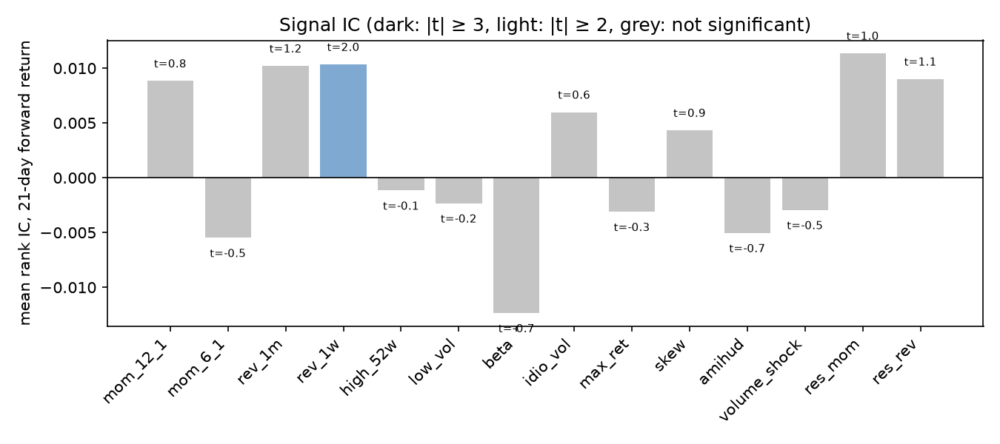
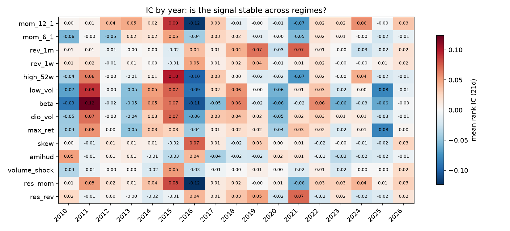
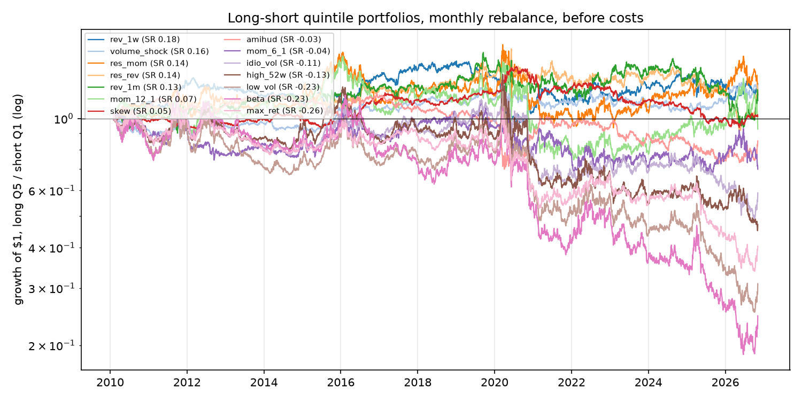
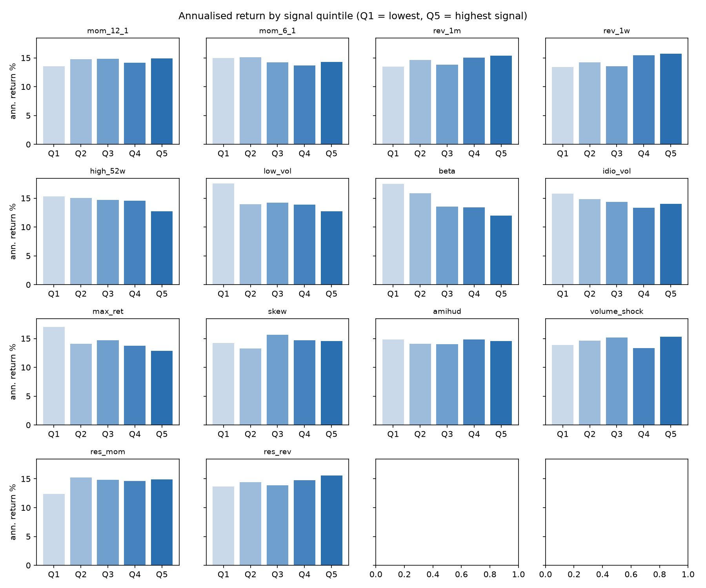
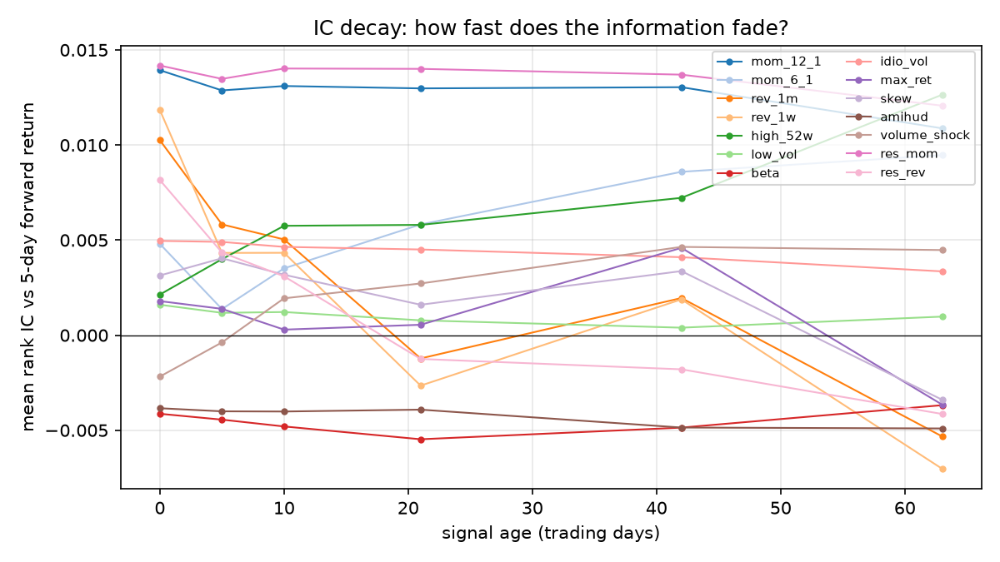

# Stage 3 — Single-signal evaluation

Sample: **2010-02-02 to 2026-11-05**, point-in-time S&P 500 members. Signals observed at the close of *t*, traded at the close of *t+1*. **No transaction costs** (Stage 5); turnover is shown so their impact can be judged.

## Summary (sorted by IC t-stat)

- **IC**: mean daily Spearman correlation between the signal and the next 21-day return. t-stats use Newey-West with 20 lags, because consecutive 21-day returns overlap.
- **IC IR**: mean/std of the IC, annualised with 12 independent periods per year.
- **L/S**: equal-weighted top quintile minus bottom quintile, rebalanced at month-ends.
- **FF6 alpha**: intercept of the L/S returns regressed on the Fama-French 5 factors + momentum.

| Signal | IC 21d | t (NW) | IC IR | Hit rate | L/S ann. return | L/S Sharpe | L/S max DD | FF6 alpha | alpha t | Turnover/month | Verdict |
|---|---|---|---|---|---|---|---|---|---|---|---|
| `rev_1w` | 0.0103 | 2.05 | 0.22 | 52.1% | 2.3% | 0.18 | -39.5% | 0.7% | 0.22 | 78.1% | weak (2 ≤ |t| < 3) |
| `rev_1m` | 0.0102 | 1.24 | 0.21 | 51.2% | 1.9% | 0.13 | -41.2% | 0.4% | 0.12 | 78.1% | not significant |
| `res_rev` | 0.0090 | 1.14 | 0.20 | 51.7% | 1.9% | 0.14 | -44.6% | 1.0% | 0.35 | 78.2% | not significant |
| `res_mom` | 0.0114 | 1.00 | 0.19 | 55.3% | 2.5% | 0.14 | -44.6% | 1.1% | 0.56 | 24.5% | not significant |
| `skew` | 0.0043 | 0.85 | 0.16 | 51.5% | 0.3% | 0.05 | -35.2% | 0.8% | 0.45 | 39.5% | not significant |
| `mom_12_1` | 0.0088 | 0.78 | 0.15 | 54.1% | 1.4% | 0.07 | -54.5% | -1.6% | -0.85 | 23.4% | not significant |
| `idio_vol` | 0.0060 | 0.56 | 0.11 | 51.5% | -1.8% | -0.11 | -63.3% | -0.7% | -0.28 | 22.1% | not significant |
| `high_52w` | -0.0012 | -0.09 | -0.02 | 51.8% | -2.6% | -0.13 | -67.0% | -1.9% | -0.71 | 36.9% | not significant |
| `low_vol` | -0.0023 | -0.17 | -0.03 | 50.6% | -4.8% | -0.23 | -79.1% | -1.3% | -0.41 | 19.7% | not significant |
| `max_ret` | -0.0031 | -0.30 | -0.06 | 50.5% | -4.2% | -0.26 | -70.0% | -1.8% | -0.68 | 60.9% | not significant |
| `volume_shock` | -0.0029 | -0.55 | -0.10 | 50.5% | 1.4% | 0.16 | -17.3% | 0.8% | 0.49 | 59.6% | not significant |
| `mom_6_1` | -0.0055 | -0.55 | -0.10 | 50.8% | -0.7% | -0.04 | -41.6% | -3.2% | -1.20 | 34.9% | not significant |
| `beta` | -0.0124 | -0.73 | -0.15 | 47.7% | -5.5% | -0.23 | -84.6% | -0.0% | -0.01 | 7.4% | not significant |
| `amihud` | -0.0050 | -0.74 | -0.14 | 47.3% | -0.3% | -0.03 | -41.9% | -1.2% | -0.85 | 6.7% | not significant |

0 of 14 signals clear |t| ≥ 3. With 14 signals × 3 horizons tested, t ≥ 3 is the relevant hurdle (Harvey, Liu & Zhu, 2016): at t ≥ 2 roughly two false positives would be expected by chance alone.

## IC across horizons

| Signal | IC 1d (t) | IC 5d (t) | IC 21d (t) |
|---|---|---|---|
| `rev_1w` | 0.0070 (2.5) | 0.0118 (2.7) | 0.0103 (2.0) |
| `rev_1m` | 0.0048 (1.6) | 0.0103 (2.1) | 0.0102 (1.2) |
| `res_rev` | 0.0032 (1.2) | 0.0082 (1.8) | 0.0090 (1.1) |
| `res_mom` | 0.0146 (4.2) | 0.0142 (2.3) | 0.0114 (1.0) |
| `skew` | 0.0028 (1.7) | 0.0031 (1.1) | 0.0043 (0.9) |
| `mom_12_1` | 0.0142 (3.9) | 0.0139 (2.2) | 0.0088 (0.8) |
| `idio_vol` | 0.0076 (2.5) | 0.0050 (0.9) | 0.0060 (0.6) |
| `high_52w` | 0.0073 (2.0) | 0.0021 (0.3) | -0.0012 (-0.1) |
| `low_vol` | 0.0065 (1.6) | 0.0016 (0.2) | -0.0023 (-0.2) |
| `max_ret` | 0.0060 (1.9) | 0.0018 (0.3) | -0.0031 (-0.3) |
| `volume_shock` | 0.0005 (0.3) | -0.0022 (-0.7) | -0.0029 (-0.5) |
| `mom_6_1` | 0.0096 (2.9) | 0.0048 (0.8) | -0.0055 (-0.5) |
| `beta` | 0.0017 (0.4) | -0.0041 (-0.5) | -0.0124 (-0.7) |
| `amihud` | -0.0026 (-1.2) | -0.0038 (-1.1) | -0.0050 (-0.7) |

## Stability across years

## Long-short performance

## Monotonicity across quintiles

A real effect should show returns rising (roughly) steadily from Q1 to Q5, not only in one extreme quintile.

## IC decay

## Factor exposures of the long-short portfolios

Coefficient (Newey-West t-stat). A significant alpha means the signal is not just a repackaged known factor.

| Signal | alpha (ann.) | Mkt-RF | SMB | HML | RMW | CMA | MOM | R² |
|---|---|---|---|---|---|---|---|---|
| `rev_1w` | 0.7% (0.2) | 0.13 (3.0) | 0.05 (1.2) | -0.02 (-0.2) | -0.02 (-0.4) | 0.16 (1.8) | -0.08 (-2.2) | 0.05 |
| `rev_1m` | 0.4% (0.1) | 0.16 (5.3) | 0.06 (1.5) | 0.01 (0.2) | 0.02 (0.3) | 0.02 (0.2) | -0.30 (-8.2) | 0.17 |
| `res_rev` | 1.0% (0.3) | 0.11 (5.3) | 0.10 (2.8) | 0.02 (0.3) | -0.02 (-0.5) | 0.04 (0.6) | -0.26 (-7.6) | 0.16 |
| `res_mom` | 1.1% (0.6) | -0.14 (-9.1) | -0.14 (-4.9) | -0.14 (-5.1) | -0.07 (-2.5) | -0.10 (-2.0) | 0.88 (52.7) | 0.80 |
| `skew` | 0.8% (0.4) | -0.04 (-3.0) | -0.05 (-2.4) | -0.02 (-0.8) | 0.07 (3.0) | 0.07 (1.9) | -0.03 (-1.4) | 0.04 |
| `mom_12_1` | -1.6% (-0.8) | -0.04 (-2.1) | -0.12 (-4.2) | -0.07 (-2.4) | -0.20 (-7.1) | -0.06 (-1.2) | 1.03 (48.8) | 0.84 |
| `idio_vol` | -0.7% (-0.3) | -0.34 (-11.0) | -0.41 (-12.4) | -0.20 (-4.9) | 0.42 (9.6) | 0.14 (2.3) | 0.28 (8.4) | 0.54 |
| `high_52w` | -1.9% (-0.7) | -0.37 (-16.1) | -0.31 (-9.2) | -0.11 (-2.5) | 0.15 (4.0) | 0.02 (0.3) | 0.80 (35.6) | 0.71 |
| `low_vol` | -1.3% (-0.4) | -0.57 (-15.2) | -0.45 (-11.4) | -0.24 (-5.1) | 0.51 (9.6) | 0.31 (4.0) | 0.34 (10.5) | 0.61 |
| `max_ret` | -1.8% (-0.7) | -0.41 (-12.5) | -0.31 (-9.7) | -0.18 (-4.5) | 0.41 (9.4) | 0.20 (3.6) | 0.22 (7.8) | 0.55 |
| `volume_shock` | 0.8% (0.5) | -0.05 (-6.0) | -0.05 (-2.9) | 0.03 (1.4) | -0.07 (-2.7) | -0.07 (-2.0) | 0.37 (22.5) | 0.45 |
| `mom_6_1` | -3.2% (-1.2) | -0.04 (-1.7) | -0.11 (-3.2) | 0.02 (0.5) | -0.09 (-2.2) | -0.10 (-1.7) | 0.83 (29.0) | 0.61 |
| `beta` | -0.0% (-0.0) | -0.73 (-15.2) | -0.35 (-9.0) | -0.35 (-6.0) | 0.60 (10.0) | 0.52 (5.7) | 0.26 (6.4) | 0.62 |
| `amihud` | -1.2% (-0.8) | 0.14 (12.5) | 0.45 (29.7) | 0.26 (13.8) | 0.11 (6.4) | 0.10 (3.3) | -0.26 (-21.0) | 0.70 |

## Caveats

- Large-cap universe: anomalies are known to be weaker among S&P 500 stocks than in small caps.
- Equal-weighted quintiles of ~100 stocks; no costs, borrow fees or capacity limits yet.
- Delisting returns are not available in free data; a delisted stock drops out of its portfolio from its last trading day.
- Fama-French factors end at the latest published month; the regression uses the overlapping period.
