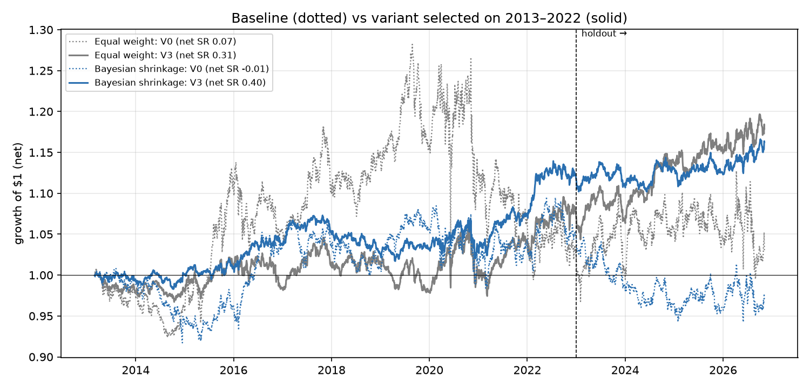
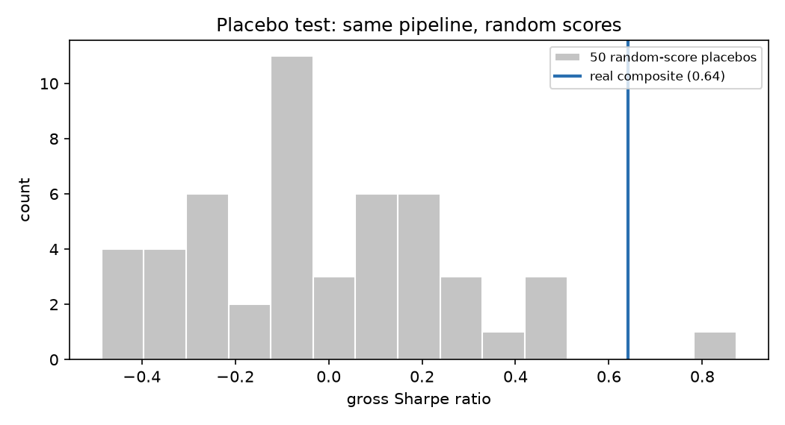

# Stage 7 — Improvements (development vs holdout)

**Protocol, fixed before running.** Development period: start of trading to 2022-12-31; holdout: 2023-01-01 to the end of the data. Each variant adds one idea motivated by theory, with parameters set a priori (5 PCA factors, 50% / 25% trade rates). For each method, the variant with the best *development* net Sharpe is selected and its holdout result is reported as is. Caveat: full-sample results of the baseline had been seen before this protocol was set, so the holdout is not perfectly untouched; the improvements themselves were never evaluated on it before selection.

## The ideas

1. **Statistical risk model.** Neutralise signals, training returns and the portfolio to the first five principal components of trailing one-year returns, on top of market beta. In large caps these are market, sector and style factors; without point-in-time sector data this is the standard way to remove them, and it removes noise the signals are not meant to bet on.
2. **Risk-scaled weights.** Weight ∝ score / idiosyncratic volatility. With alpha = IC × σ × z (Grinold), the optimal weight under a factor model is ∝ z / σ: the same conviction takes a smaller position in a more volatile stock, so risk is spread more evenly.
3. **Cost-aware trading.** Move only part of the way to the target each month. Under quadratic trading costs this is the optimal policy (Gârleanu & Pedersen, 2013): trade towards an aim portfolio at a rate set by costs and alpha decay. Stage 6 showed turnover is the binding constraint.

## Results

| Variant | Method | Dev Sharpe gross | Dev Sharpe net | Holdout Sharpe gross | Holdout Sharpe net | Full net | Vol | Max DD | Turnover/month |
|---|---|---|---|---|---|---|---|---|---|
| V0 baseline (beta-neutral, rank weights, full rebalance) | Equal weight | 0.22 | 0.08 | 0.19 | 0.05 | 0.07 | 9.4% | -24.5% | 86% |
| V0 baseline (beta-neutral, rank weights, full rebalance) | Bayesian shrinkage | 0.35 | 0.12 | -0.12 | -0.34 | -0.01 | 5.5% | -14.0% | 82% |
| V1 + statistical risk model (5 PCA factors) | Equal weight | 0.33 | 0.07 | 0.54 | 0.30 | 0.14 | 5.4% | -8.0% | 93% |
| V1 + statistical risk model (5 PCA factors) | Bayesian shrinkage | 0.63 | 0.28 | 0.43 | 0.11 | 0.23 | 4.1% | -7.0% | 93% |
| V2 + risk-scaled weights (z / idio vol) | Equal weight | 0.38 | 0.11 | 0.60 | 0.34 | 0.18 | 5.0% | -7.6% | 93% |
| V2 + risk-scaled weights (z / idio vol) | Bayesian shrinkage | 0.69 | 0.30 | 0.45 | 0.09 | 0.24 | 3.7% | -6.5% | 94% |
| V3 + trade 50% towards target **(selected)** | Equal weight | 0.37 | 0.20 | 0.74 | 0.58 | 0.31 | 4.2% | -8.4% | 42% |
| V3 + trade 50% towards target **(selected)** | Bayesian shrinkage | 0.66 | 0.42 | 0.58 | 0.35 | 0.40 | 2.9% | -5.2% | 43% |
| V4 + trade 25% towards target | Equal weight | 0.29 | 0.17 | 0.88 | 0.77 | 0.34 | 3.5% | -8.4% | 22% |
| V4 + trade 25% towards target | Bayesian shrinkage | 0.48 | 0.30 | 0.61 | 0.44 | 0.34 | 2.4% | -5.2% | 22% |

## Factor attribution of the selected Bayesian book (V3)

| Factor | Loading | t (Newey-West) |
|---|---|---|
| alpha | +0.010 | +1.39 |
| Mkt-RF | -0.005 | -1.48 |
| SMB | +0.036 | +5.32 |
| HML | +0.004 | +0.56 |
| RMW | +0.010 | +1.22 |
| CMA | +0.009 | +0.81 |
| MOM | +0.062 | +8.28 |
| R² | 0.12 | |

Alpha is annualised. A book neutral to statistical factors should load little on the Fama-French factors.

## Placebo test (is the machine itself producing returns?)

The selected configuration is fed 50 sets of *random* scores (same dates, same stocks). A correct pipeline must earn nothing from noise; a positive average would reveal look-ahead or a construction bias.

Placebo gross Sharpe: mean -0.01, standard deviation 0.28, max +0.87. Real signal: **+0.64**, empirical p-value 0.039.

## Cost sensitivity of the selected Bayesian book

| Cost (bps per $ traded) | 0 | 2 | 5 | 10 | 20 | 30 |
|---|---|---|---|---|---|---|
| Net Sharpe | 0.58 | 0.50 | 0.40 | 0.22 | -0.14 | -0.48 |

## Survivorship bias, selected configuration

Same configuration and the 12 original signals on the main data and on a yfinance-only snapshot (which silently drops every delisted stock).

| Method | Dataset | Sharpe gross | Sharpe net | Return net | Vol |
|---|---|---|---|---|---|
| Equal weight | with delisted stocks (main) | 0.44 | 0.29 | 1.3% | 4.5% |
| Bayesian shrinkage | with delisted stocks (main) | 0.63 | 0.39 | 1.1% | 2.9% |
| Equal weight | survivors only (yfinance) | 0.47 | 0.31 | 1.4% | 4.4% |
| Bayesian shrinkage | survivors only (yfinance) | 0.70 | 0.45 | 1.3% | 2.9% |

