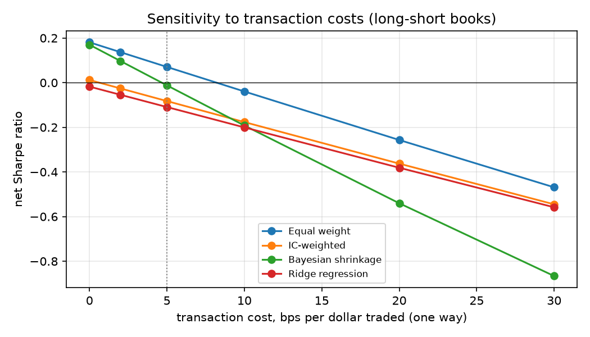

# Stage 6 — Robustness

Each section changes one assumption of the Stage 5 long-short setup (monthly rebalance, beta-neutral, 5 bps costs, 25 bps borrow, full rebalancing). None of these variants was used to choose the main configuration.

## 1. Transaction costs

Net Sharpe ratio for different cost assumptions (5 bps is the base case).

| Method | 0 bps | 2 bps | 5 bps | 10 bps | 20 bps | 30 bps | Break-even cost |
|---|---|---|---|---|---|---|---|
| Equal weight | 0.18 | 0.14 | 0.07 | -0.04 | -0.26 | -0.47 | 9 bps |
| IC-weighted | 0.01 | -0.03 | -0.08 | -0.18 | -0.36 | -0.55 | 1 bps |
| Bayesian shrinkage | 0.17 | 0.10 | -0.01 | -0.19 | -0.54 | -0.87 | 5 bps |
| Ridge regression | -0.02 | -0.05 | -0.11 | -0.20 | -0.38 | -0.56 | 0 bps |

## 2. Turnover control (partial rebalancing)

Each month the book moves only part of the way from its drifted weights to the new target. Less trading lowers costs but also dilutes the signal (slower to react).

| Variant | Sharpe gross | Sharpe net | Return net | Vol | Max DD | Turnover/month |
|---|---|---|---|---|---|---|
| Equal weight, trade 100% of the way to target | 0.21 | 0.07 | 0.7% | 9.4% | -24.5% | 86% |
| Equal weight, trade 50% of the way to target | 0.24 | 0.16 | 1.4% | 8.3% | -20.9% | 39% |
| Equal weight, trade 25% of the way to target | 0.25 | 0.20 | 1.4% | 7.1% | -22.1% | 20% |
| Bayesian shrinkage, trade 100% of the way to target | 0.22 | -0.01 | -0.1% | 5.5% | -14.0% | 82% |
| Bayesian shrinkage, trade 50% of the way to target | 0.18 | 0.03 | 0.1% | 4.4% | -10.5% | 39% |
| Bayesian shrinkage, trade 25% of the way to target | 0.08 | -0.03 | -0.1% | 3.7% | -10.9% | 20% |

## 3. Sub-periods

First half: 2013-03 to 2019-12; second half: 2020-01 to the end (includes COVID and the 2022 rate shock).

| Method | Period | Sharpe gross | Sharpe net | Return net |
|---|---|---|---|---|
| Equal weight | first half | 0.51 | 0.33 | 2.4% |
| Equal weight | second half | 0.02 | -0.09 | -1.0% |
| IC-weighted | first half | 0.14 | -0.03 | -0.2% |
| IC-weighted | second half | -0.03 | -0.12 | -1.6% |
| Bayesian shrinkage | first half | 0.50 | 0.21 | 0.9% |
| Bayesian shrinkage | second half | 0.03 | -0.16 | -1.0% |
| Ridge regression | first half | 0.06 | -0.11 | -0.8% |
| Ridge regression | second half | -0.03 | -0.12 | -1.5% |

## 4. Prior sensitivity (Bayesian shrinkage)

The prior only sets the *level* of the common premium; with non-negative weights it matters mostly when the data push the common level towards zero (then the book stops trading).

| Variant | Sharpe gross | Sharpe net | Return net | Vol | Max DD | Turnover/month |
|---|---|---|---|---|---|---|
| prior IC 0.00 ± 0.01 | 0.21 | -0.02 | -0.1% | 5.5% | -14.0% | 82% |
| prior IC 0.00 ± 0.02 | 0.21 | -0.02 | -0.1% | 5.5% | -14.0% | 82% |
| prior IC 0.02 ± 0.02 (base) | 0.22 | -0.01 | -0.1% | 5.5% | -14.0% | 82% |
| prior IC 0.05 ± 0.02 | 0.22 | -0.01 | -0.1% | 5.5% | -14.0% | 82% |
| prior IC 0.02 ± 0.05 | 0.21 | -0.01 | -0.1% | 5.5% | -14.0% | 82% |

## 5. Leave one signal out

Gross Sharpe when a single signal is removed before combining. A large drop means the result depends on that one signal.

All signals: equal weight 0.21, Bayesian 0.22.

| Variant | Equal weight (gross SR) | Bayesian (gross SR) | Bayesian change |
|---|---|---|---|
| without `mom_12_1` | 0.19 | 0.20 | -0.02 |
| without `mom_6_1` | 0.22 | 0.21 | -0.00 |
| without `rev_1m` | 0.22 | 0.23 | +0.01 |
| without `rev_1w` | 0.21 | 0.20 | -0.02 |
| without `high_52w` | 0.20 | 0.20 | -0.02 |
| without `low_vol` | 0.22 | 0.21 | -0.00 |
| without `beta` | 0.18 | 0.15 | -0.06 |
| without `idio_vol` | 0.23 | 0.24 | +0.02 |
| without `max_ret` | 0.20 | 0.21 | -0.00 |
| without `skew` | 0.17 | -0.05 | -0.27 |
| without `amihud` | 0.26 | 0.46 | +0.24 |
| without `volume_shock` | 0.20 | 0.18 | -0.03 |
| without `res_mom` | 0.18 | 0.20 | -0.02 |
| without `res_rev` | 0.21 | 0.23 | +0.01 |

## 6. Rebalance frequency

Weekly rebalancing reacts faster to the short-horizon signals (reversal) but trades ~4x as often. Weekly weights use a 156-week burn-in (same 3 years).

| Variant | Sharpe gross | Sharpe net | Return net | Vol | Max DD | Turnover/month |
|---|---|---|---|---|---|---|
| Equal weight, monthly (base) | 0.21 | 0.07 | 0.7% | 9.4% | -24.5% | 86% |
| Bayesian shrinkage, monthly (base) | 0.22 | -0.01 | -0.1% | 5.5% | -14.0% | 82% |
| Equal weight, weekly | 0.38 | 0.10 | 1.0% | 9.6% | -23.6% | 198% |
| Bayesian shrinkage, weekly | 0.23 | -0.09 | -0.5% | 5.7% | -21.1% | 131% |

## 7. Survivorship bias

Same pipeline and the same 12 signals on two datasets: the main one (delisted stocks filled from Tiingo) and a snapshot built from yfinance only, which silently drops every stock that no longer trades.

| Variant | Sharpe gross | Sharpe net | Return net | Vol | Max DD | Turnover/month |
|---|---|---|---|---|---|---|
| Equal weight, with delisted stocks (main) | 0.18 | 0.06 | 0.5% | 9.4% | -24.2% | 76% |
| IC-weighted, with delisted stocks (main) | -0.02 | -0.14 | -1.5% | 11.0% | -31.7% | 84% |
| Bayesian shrinkage, with delisted stocks (main) | 0.21 | -0.02 | -0.1% | 5.5% | -14.3% | 82% |
| Ridge regression, with delisted stocks (main) | -0.02 | -0.14 | -1.4% | 10.3% | -29.4% | 78% |
| Equal weight, survivors only (yfinance) | 0.15 | 0.02 | 0.2% | 9.2% | -23.4% | 76% |
| IC-weighted, survivors only (yfinance) | -0.03 | -0.16 | -1.6% | 10.1% | -28.7% | 94% |
| Bayesian shrinkage, survivors only (yfinance) | 0.21 | -0.01 | -0.1% | 5.7% | -14.4% | 85% |
| Ridge regression, survivors only (yfinance) | -0.05 | -0.18 | -1.7% | 9.6% | -30.1% | 83% |

