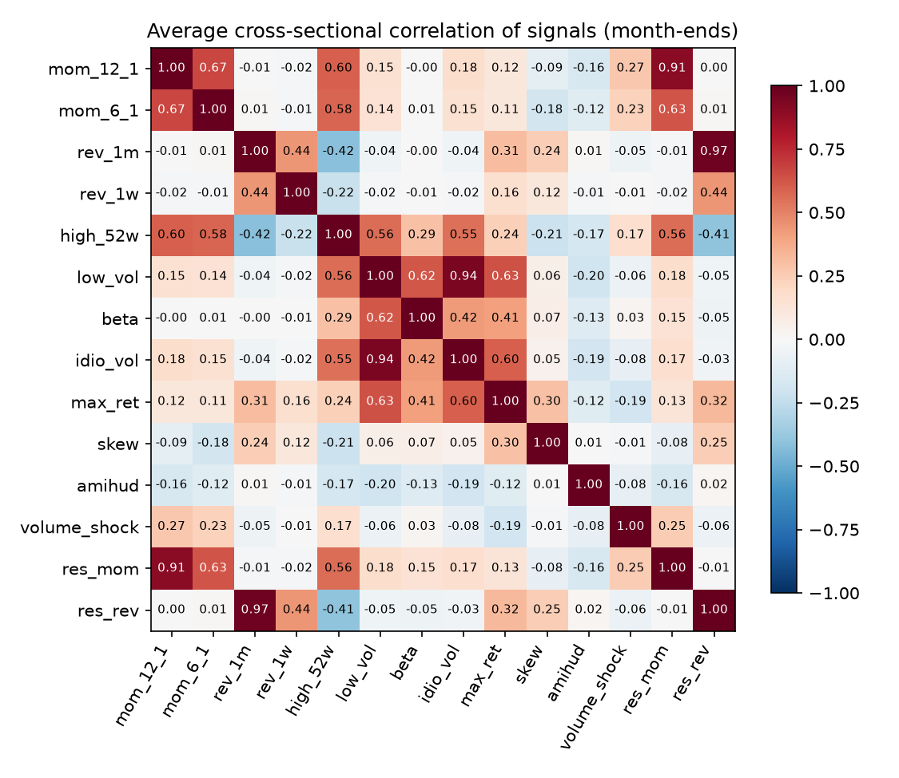

# Signal report

Signals are computed from data up to the close of day *t*; trades are assumed at the close of *t+1*. Each signal is oriented so that **higher = higher expected return**, then winsorized (1%/99%) and z-scored across the S&P 500 members of that day.

## Signals

| Signal | Definition | Sign | Reference | Avg coverage of universe | First date |
|---|---|---|---|---|---|
| `mom_12_1` | 12-month return skipping the last month | + | Jegadeesh & Titman (1993) | 99.6% | 2010-01-04 |
| `mom_6_1` | 6-month return skipping the last month | + | Jegadeesh & Titman (1993) | 99.8% | 2010-01-04 |
| `rev_1m` | 1-month return (reversal) | − | Jegadeesh (1990) | 100.0% | 2010-01-04 |
| `rev_1w` | 1-week return (reversal) | − | Lehmann (1990) | 100.0% | 2010-01-04 |
| `high_52w` | price / 52-week high | + | George & Hwang (2004) | 99.6% | 2010-01-04 |
| `low_vol` | 3-month daily volatility | − | Ang, Hodrick, Xing & Zhang (2006) | 99.9% | 2010-01-04 |
| `beta` | 12-month market beta vs SPY | − | Frazzini & Pedersen (2014) | 99.6% | 2010-01-04 |
| `idio_vol` | 3-month idiosyncratic volatility | − | Ang, Hodrick, Xing & Zhang (2006) | 99.9% | 2010-01-04 |
| `max_ret` | max daily return over 1 month (lottery demand) | − | Bali, Cakici & Whitelaw (2011) | 100.0% | 2010-01-04 |
| `skew` | 3-month skewness of daily returns | − | Boyer, Mitton & Vorkink (2010) | 99.9% | 2010-01-04 |
| `amihud` | Amihud illiquidity, 3 months | + | Amihud (2002) | 99.9% | 2010-01-04 |
| `volume_shock` | 1-month vs 12-month dollar volume | + | Gervais, Kaniel & Mingelgrin (2001) | 99.6% | 2010-01-04 |
| `res_mom` | 12-1 month residual (market-model) momentum, vol-scaled | + | Blitz, Huij & Martens (2011) | 99.2% | 2010-01-04 |
| `res_rev` | 1-month residual return (reversal) | − | Blitz, Huij, Lansdorp & Verbeek (2013) | 99.6% | 2010-01-04 |

## Correlation between signals

Most correlated pairs (|ρ|): `res_rev`/`rev_1m` 0.97, `idio_vol`/`low_vol` 0.94, `res_mom`/`mom_12_1` 0.91, `mom_6_1`/`mom_12_1` 0.67, `low_vol`/`max_ret` 0.63.

Highly correlated signals carry largely the same information; the combination step (Stage 4) has to account for this rather than count the same bet twice.
